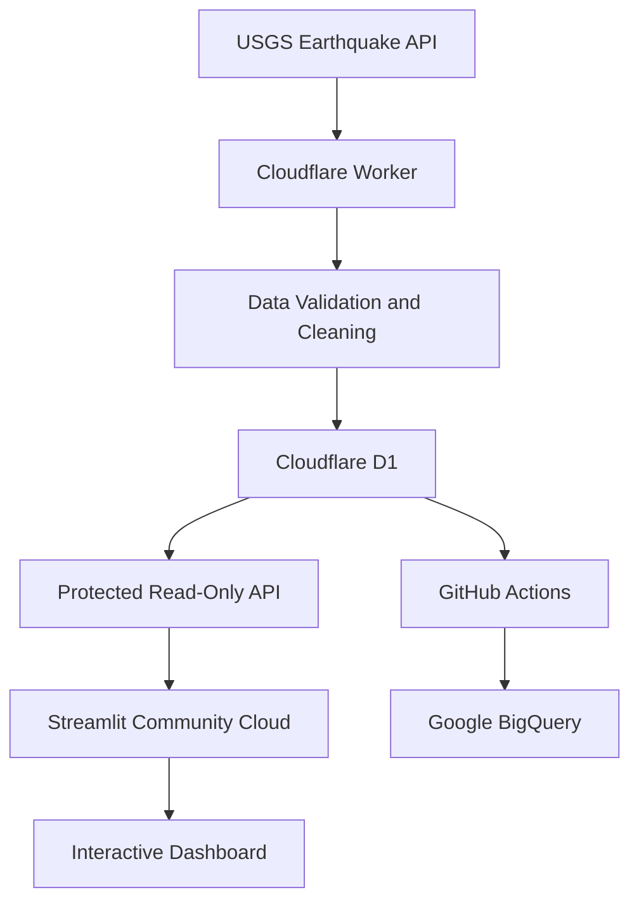

# 🌍 Earthquake Monitoring Dashboard

An interactive earthquake monitoring dashboard built with **Streamlit**, providing near-real-time exploration of earthquake events collected from the official **USGS Earthquake API**.

The dashboard retrieves structured earthquake records from a protected Cloudflare Worker API and presents them through interactive metrics, charts, geographical visualisations and data tables.

It is the visualisation component of the larger Earthquake Monitoring System.

## 🔗 Related Projects

This dashboard is connected to a separate cloud data engineering repository.

- **Backend Data Engineering System:** [earthquake_monitoring_system](https://github.com/Pawarasithumina/earthquake_monitoring_system)
- **Live Dashboard:** [Open Earthquake Monitoring Dashboard](https://earthquakemonitoringdashboard-lkomffwk24fzph9xdsjmji.streamlit.app/)

The backend repository handles earthquake data extraction, validation, storage and warehouse integration. This repository focuses on interactive data exploration and visualisation.

---

## 📌 Project Overview

Earthquake events occur globally and generate valuable information about seismic activity.

However, raw earthquake data can be difficult to explore without appropriate visualisation tools.

This project provides an interactive dashboard that allows users to explore earthquake records using statistics, charts, geographical maps and filters.

The dashboard retrieves data from the Cloudflare Worker API, which reads structured records from Cloudflare D1.

The data ingestion and processing pipeline runs separately in the cloud. The dashboard is responsible for presenting and exploring the available data.

---

## 🏗️ System Architecture



### Architecture Components

| Component | Technology | Responsibility |
|---|---|---|
| Data Source | USGS Earthquake API | Provides earthquake event information |
| Backend Processing | Cloudflare Workers | Handles ingestion and basic processing |
| Relational Storage | Cloudflare D1 | Stores structured earthquake records |
| API | Cloudflare Worker API | Provides protected read-only data access |
| Frontend | Streamlit | Builds the interactive dashboard |
| Hosting | Streamlit Community Cloud | Hosts the dashboard application |
| Analytical Warehouse | Google BigQuery | Stores records for analytical SQL queries |
| Automation | GitHub Actions | Transfers data from D1 to BigQuery |

---

## ✨ Dashboard Features

### 1. Key Performance Indicators

The dashboard displays important earthquake statistics, including:

- Total earthquake events.
- Average earthquake magnitude.
- Maximum earthquake magnitude.
- Latest recorded earthquake event.

### 2. Interactive Filters

Users can filter earthquake records using:

- Date range.
- Magnitude range.
- Location.

These filters allow users to focus on specific earthquake events and periods.

### 3. Daily Earthquake Activity

A time-series chart displays earthquake activity over time.

This helps users explore changes in earthquake frequency across the selected date range.

### 4. Magnitude Distribution

A magnitude distribution visualisation helps users understand the frequency of events across different magnitude levels.

### 5. Interactive Earthquake Map

The geographical map displays earthquake event locations using their latitude and longitude coordinates.

This helps users explore the geographical distribution of recorded earthquake events.

### 6. Recent Earthquake Records

The dashboard includes a table of recent earthquake events with relevant information.

Where available, users can follow the original USGS event links for additional details.

### 7. CSV Export

Users can download filtered earthquake records in CSV format for further analysis.

---

## 🛠️ Technologies Used

### Frontend and Visualisation
- Python
- Streamlit
- Interactive charting and mapping libraries used by the application

### Backend and Data Access
- Cloudflare Workers
- Cloudflare D1
- REST API
- JSON

### Data Source
- USGS Earthquake API

### Data Warehouse
- Google BigQuery

### Hosting
- Streamlit Community Cloud

### Version Control
- Git
- GitHub

---

## 🌐 Data Source

The dashboard uses earthquake event information originating from the official United States Geological Survey (USGS) Earthquake API.

Official documentation:

https://earthquake.usgs.gov/fdsnws/event/1/

The backend ingestion system collects the earthquake data and stores structured records in Cloudflare D1.

The dashboard accesses the stored records through the protected Cloudflare Worker API rather than directly accessing the USGS API.

### Main Data Fields

| Field | Description |
|---|---|
| event_id | Unique earthquake event identifier |
| magnitude | Earthquake magnitude |
| place | Human-readable event location |
| event_time | Date and time of the earthquake |
| depth_km | Earthquake depth in kilometres |
| longitude | Geographic longitude |
| latitude | Geographic latitude |
| event_url | Original USGS event information link |
| ingestion_time | Record ingestion timestamp |

---

## 🔌 Backend API Integration

The dashboard retrieves data through the protected Cloudflare Worker export endpoint.

### API Endpoint

```text
https://earthquake-monitoring-system.pawarasithumina24.workers.dev/api/warehouse-export
```

### Authentication

The endpoint requires a bearer token.

The dashboard uses the following Streamlit secret:

```toml
CLOUDFLARE_EXPORT_SECRET = "your_worker_export_secret"
```

The value must match the Cloudflare Worker secret:

```text
WAREHOUSE_EXPORT_SECRET
```

The secret is configured through the Streamlit Community Cloud application settings.

It must never be committed to GitHub or included directly in the source code.

### Pagination

The API supports paginated data retrieval using:

- `limit`
- `offset`

Example:

```text
/api/warehouse-export?limit=100&offset=0
```

The dashboard retrieves records through this endpoint and uses them for its visualisations and filtering features.

---

## 📁 Project Structure

```text
earthquake_monitoring_dashboard/
│
├── app.py
├── requirements.txt
└── README.md
```

---

## 🚀 Deployment

The dashboard is hosted using Streamlit Community Cloud.

### Live Application

[Earthquake Monitoring Dashboard](https://earthquakemonitoringdashboard-lkomffwk24fzph9xdsjmji.streamlit.app/)

### Deployment Configuration

| Setting | Value |
|---|---|
| Hosting Platform | Streamlit Community Cloud |
| GitHub Repository | earthquake_monitoring_dashboard |
| Main Application File | app.py |
| Requirements File | requirements.txt |

### Deployment Steps

1. Push the dashboard source code to the GitHub repository.
2. Open [Streamlit Community Cloud](https://share.streamlit.io/).
3. Connect the GitHub repository.
4. Select `app.py` as the application entry point.
5. Configure the required application secret.
6. Deploy the application.

Streamlit Community Cloud can automatically update the application when changes are pushed to the connected repository.

---

## 🔐 Security

The dashboard uses a protected backend API to retrieve earthquake records.

Security considerations include:

- API authentication through bearer tokens.
- Secrets stored using Streamlit Community Cloud's Secrets settings.
- No authentication credentials committed to GitHub.
- Read-only access to the backend export endpoint.
- No direct modification of the backend database by the dashboard.

---

## ☁️ Cloud Integration

This dashboard is part of a larger cloud data engineering architecture.

The backend handles:

- Automated earthquake data extraction.
- Data validation and basic cleaning.
- Raw data storage in Cloudflare KV.
- Structured data storage in Cloudflare D1.
- Automated data transfer to Google BigQuery.

The dashboard handles:

- Retrieving stored earthquake records.
- Interactive filtering.
- Statistical summaries.
- Charts and geographical visualisation.
- Filtered data export.

Keeping these responsibilities separate makes the overall system easier to maintain and extend.

---

## 💰 Cost Management

The project uses cloud services and available free-tier or sandbox resources wherever possible.

The selected services include:

- Cloudflare Workers.
- Cloudflare D1.
- Streamlit Community Cloud.
- Google BigQuery Sandbox.
- GitHub Actions.

Usage quotas and service policies should be monitored to avoid unexpected charges.

---

## 🔮 Future Improvements

Potential future enhancements include:

- Additional earthquake trend visualisations.
- More detailed geographical analysis.
- Improved dashboard filtering.
- Magnitude-based event categorisation.
- Historical earthquake comparisons.
- Enhanced data refresh and caching controls.
- Additional analytical views based on BigQuery data.

---

## 🎓 Academic Project

**Project Title:** Earthquake Monitoring System

**Module:** Cloud Data Engineering

**Programme:** HND in Data Science

**Institution:** NIBM

**Project Component:** Interactive Data Visualisation Dashboard

---

## 📚 References

- [USGS Earthquake API](https://earthquake.usgs.gov/fdsnws/event/1/)
- [Streamlit Documentation](https://docs.streamlit.io/)
- [Streamlit Community Cloud](https://share.streamlit.io/)
- [Cloudflare Workers Documentation](https://developers.cloudflare.com/workers/)
- [Cloudflare D1 Documentation](https://developers.cloudflare.com/d1/)
- [Google BigQuery Documentation](https://cloud.google.com/bigquery/docs)

---

**Earthquake Monitoring Dashboard**

*Turning earthquake event data into interactive insights.*
